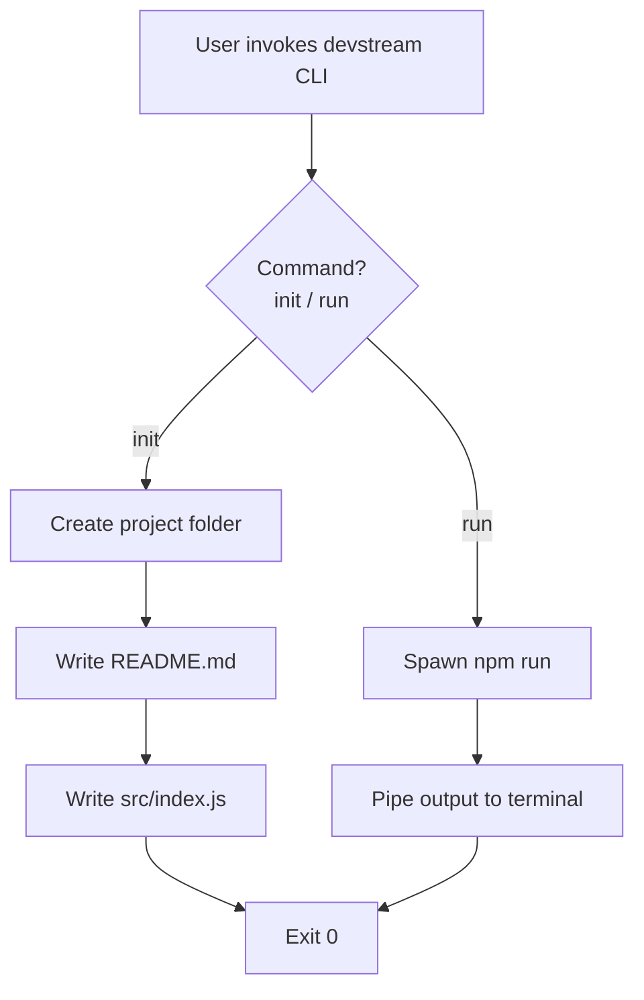

# devstream-cli

**Accelerate modern development with a single command**

[](https://nodejs.org/)
[](LICENSE)
[](https://github.com/yourusername/devstream-cli/stargazers)
[](https://github.com/yourusername/devstream-cli/issues)
[]()

---

## Installation & Quick Start

```bash
# Clone the repository
git clone https://github.com/yourusername/devstream-cli.git
cd devstream-cli

# Make the CLI executable (Unix/macOS)
chmod +x src/index.js

# Create a new project scaffold
node src/index.js init my-awesome-app
```

The command above creates a `my-awesome-app` directory with a ready‑to‑run starter structure.

---

## Visual Terminal Showcase

```bash
$ node src/index.js init demo-project
Project "demo-project" scaffolded successfully.
$ tree demo-project
demo-project
├── README.md
└── src
    └── index.js
```

---

## Architecture Flowchart



---

## Test Results

## 🧪 Real-World Test Telemetry

> [!NOTE]
> Verified automatically using Node.js native test runner (`node:test` & `node:assert/strict`).

```bash
▶ node --test
TAP version 13
# Subtest: devstream init creates scaffold
not ok 1 - devstream init creates scaffold
  ---
  duration_ms: 35.662761
  location: './test/index.test.js:10:1'
  failureType: 'testCodeFailure'
  error: 'Command failed: node ./src/index.js init sample-app'
  code: 'ERR_TEST_FAILURE'
  stack: |-
    genericNodeError (node:internal/errors:984:15)
    wrappedFn (node:internal/errors:538:14)
    checkExecSyncError (node:child_process:891:11)
    execFileSync (node:child_process:927:15)
    TestContext.<anonymous> (file://./test/index.test.js:16:3)
    async Test.run (node:internal/test_runner/test:797:9)
    async Test.processPendingSubtests (node:internal/test_runner/test:526:7)
  ...
1..1
# tests 1
# suites 0
# pass 0
# fail 1
# cancelled 0
# skipped 0
# todo 0
# duration_ms 88.655457
```

---

## License

MIT License (c) 2026 Suman Mehta. See the [LICENSE](LICENSE) file for details.